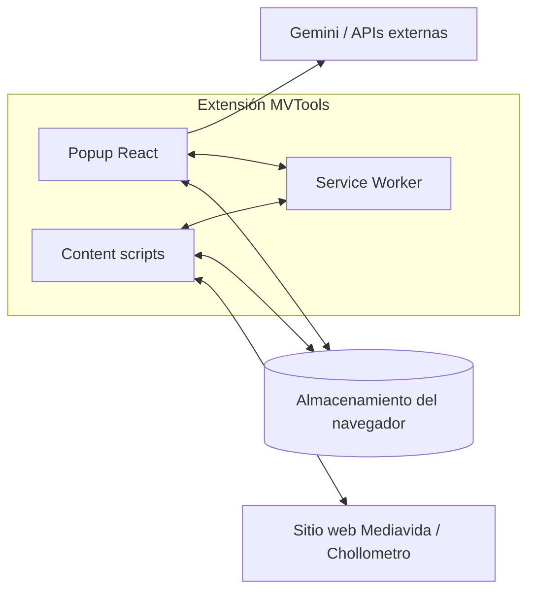

# Arquitectura: MVTools

## 1. Resumen ejecutivo

MVTools es una extensión de navegador cuyo comportamiento se reparte en tres superficies clásicas de WebExtensions: **interfaz de popup**, **content scripts** inyectados en orígenes permitidos, y **service worker** (background) para ciclo de vida, mensajes y tareas de actualización. El empaquetado lo orquesta **Vite** con un manifest generado desde TypeScript (`src/manifest.ts`) para adaptar detalles entre Chrome y Firefox.

## 2. Patrón de arquitectura

- **Vista y estado (popup y features):** componentes React, TanStack Query para datos remotos/ asíncronos, TanStack Store para configuración global donde aplica, estilos con Tailwind y primitivos Radix.
- **Integración con la página (content scripts):** entradas por sección bajo `src/entries/contentScript/sections/`, con *matches* definidos en el manifest; los componentes reaccionan al DOM de Mediavida (y otras URLs permitidas) a menudo dentro de Shadow DOM para aislamiento de estilos.
- **Orquestación en background:** `src/entries/background/service-worker.ts` escucha `runtime.onMessage`, instalación/ actualización, y coordina tareas de migración y scripts inyectados según `src/types/event-messages.ts` y `content-script-assets`.
- **Configuración y persistencia:** claves lógicas en `src/types/storage.ts` y lógica en `src/services/config.ts`, `src/services/storage.ts`, etc.

## 3. Flujo de alto nivel (vista lógica)

- El **popup** concentra ajustes globales (estilos, usuarios, Gemini, etc.).
- Los **content scripts** leen y manipulan el DOM y disparan lógica de producto (hilos, MP, reportes, marcadores, Chollometro, etc.).
- El **background** unifica mensajes, migraciones y utilidades (p. ej. *badge*, scripts dinámicos según manifiesto).

## 4. Puntos de entrada (referencia)

| Entrada | Ubicación principal | Función |
|---------|---------------------|---------|
| Popup | `src/entries/popup/` | UI de configuración y acciones |
| Content (global y por sección) | `src/entries/contentScript/` | Código inyectado por URL/match |
| Background | `src/entries/background/service-worker.ts` | MV3 *service worker* / mensajes |
| Manifest | `src/manifest.ts` + `getManifest(browser)` | Permisos, matches, *icons* |
| HMR (solo desarrollo) | `src/entries/enableDevHmr.ts` | Integración con flujo Vite |

## 5. Datos y capa de servicios

- **Servicios de dominio:** `src/services/` — p. ej. `media-vida`, `chollometro`, `gemini`, `config`, `storage`, `upgrades`.
- **Tipos compartidos:** `src/types/` — eventos, almacenamiento, dominio Mediavida.
- **No hay API HTTP propia** de producto: la “capa de API” es el uso de **fetch** / cliente del sitio y **Gemini** desde el contexto de la extensión según la configuración del usuario.

## 6. Consideraciones de UI y accesibilidad

- Uso de **Shadow DOM** en features compartidos (`src/features/shared/`) para no romper estilos del sitio; Radix con **parches pnpm** documentados en el README para diálogos bajo Shadow DOM.
- Tema: `src/providers/theme-provider.tsx` y hooks asociados.

## 7. Despliegue

- Artefacto: carpeta `dist/` tras `pnpm build` o `pnpm build:firefox`.
- Publicación: orientada a Chrome Web Store / Add-ons de Mozilla; empaquetado ZIP opcional con `ZIP=true` (ver `vite.config.ts` y README).

## 8. Pruebas

- El proyecto prioriza *lint* y comprobación de tipos; buscar `*.test.*` o patrones de test si se amplía la estrategia (no detallado en escaneo quick).

---

*Escaneo quick: estructura validada con `package.json`, `vite.config.ts`, `manifest.ts` y disposición de `src/`. Un *deep scan* añadiría referencias puntuales a módulos por feature.*
